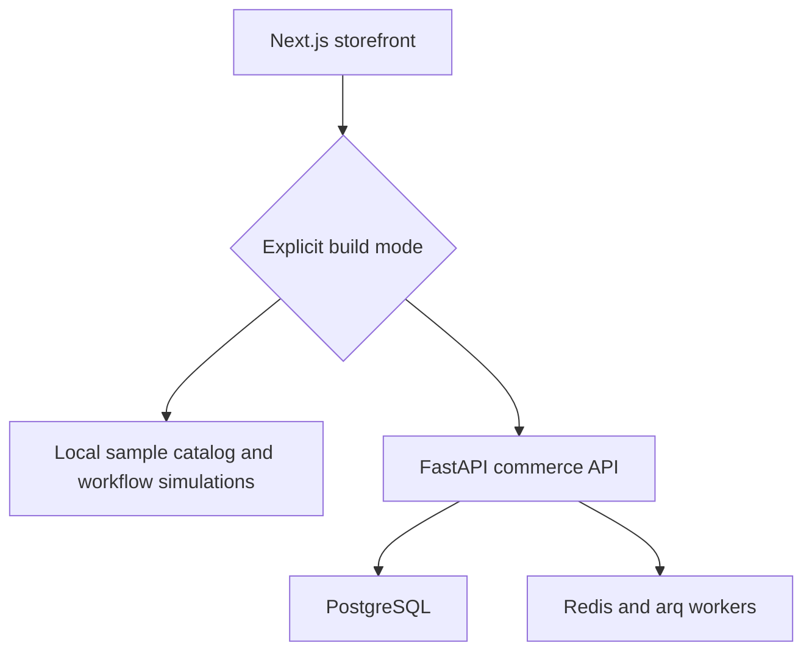

# Bazaar / ShopUnity

**Retail discovery and wholesale sourcing for Pakistani commerce.**

A buyer-reviewable portfolio demo, backed by a separate FastAPI commerce codebase. Demo mode works without PostgreSQL, Redis, AI keys, payment credentials or paid backend hosting.

[Author portfolio](https://asadullahshafique-devunity.vercel.app/) · [Readiness and buyer handoff](docs/BUYER-HANDOFF.md)

## Try the demo in two minutes

```bash
cd frontend
npm ci
npm run dev
```

Open http://localhost:3000/en. With no API URL configured, the app deliberately selects demo mode. To make that choice explicit, copy `frontend/.env.example` to `frontend/.env.local` and keep `NEXT_PUBLIC_DEMO_MODE=true`.

| Journey | What you can evaluate |
| --- | --- |
| Retail | 12 illustrated sample products, search, category and price filters, product details, supplier profiles and a persisted cart |
| Wholesale | Delivered-cost comparison, minimum order quantity, budget and delivery constraints, explained shortlist, human approval and brief export |
| Seller | Simulated order fulfilment stages and illustrative low-stock signals |
| Checkout | No-signup simulated receipt; no personal information or payment collected |

All suppliers, artwork, prices, stock and offers in demo mode are illustrative. No real orders, seller verification, customer counts or payment settlement are claimed. The sourcing comparator is deterministic logic, not an AI agent. Demo mutations cannot reach the commerce API, and live API failures never silently fall back to demo data.

## Architecture



| Layer | Actual implementation |
| --- | --- |
| Frontend | Next.js 14, React 18, TypeScript, Tailwind, Zustand |
| Locale infrastructure | next-intl: English, Arabic and Urdu routes with RTL layout; newer showcase copy is English |
| Backend | FastAPI, async SQLAlchemy, PostgreSQL, JWT authentication |
| Cache / jobs | Redis, arq |
| Provider adapters | Payment, email, WhatsApp, R2 storage, translation and Claude listing tools; require credentials and validation |

This repository is the home for these demo improvements. `shopunityvoice` shares earlier history but does not automatically receive changes here.

## Verification

```bash
cd frontend
npm test
npm run lint
npx tsc --noEmit
npm run build
# Browser checks, when Chromium is installed:
npx playwright install chromium
npm run test:e2e
```

Backend tests require a disposable local PostgreSQL database. See [buyer handoff](docs/BUYER-HANDOFF.md) for launch gaps and acceptance criteria. Passing frontend checks does not certify live payments or backend commerce.

## Hosting the portfolio demo

Import this repository into Vercel with **Root Directory = frontend** and set `NEXT_PUBLIC_DEMO_MODE=true`. No backend provider or AI subscription is required. A pre-existing API URL may remain, but explicit demo mode prevents all demo API calls from reaching it. Set `NEXT_PUBLIC_BASE_URL` to your actual deployment origin. Rebuild after changing public environment variables.

## Local backend development

```bash
cp backend/.env.example backend/.env
# Development credentials only; replace before any real deployment.
docker compose up -d postgres redis
cd backend
python -m venv .venv
source .venv/bin/activate
pip install -r requirements.txt -r requirements-dev.txt
alembic upgrade head
uvicorn app.main:app --reload --port 8000
```

Run the frontend separately with `NEXT_PUBLIC_DEMO_MODE=false` and `NEXT_PUBLIC_API_URL=http://localhost:8000`. Demo checkout is isolated from this live path. The legacy Docker frontend build needs public environment variables at build time; the separate local frontend command avoids that ambiguity.

## Contributing

Use focused branches and pull requests. Run the frontend checks above, and run backend tests against a disposable Postgres/Redis instance for backend changes. Do not commit credentials, claim unverified traction or present sample data as real commerce. See [CONTRIBUTING.md](CONTRIBUTING.md).

Built by **Asadullah Shafique — Agentic AI Engineer**.
